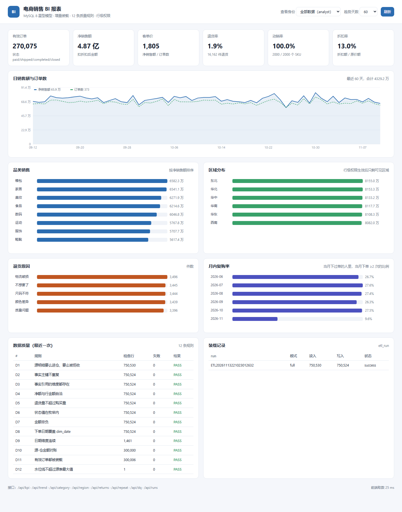

# 电商销售 BI 报表

一套能跑起来的 BI 工程：合成电商数据 → 星型模型仓库 → 12 条质量规则 → 指标视图 → FastAPI 接口 → 原生 SVG 看板。



数据库用 MySQL 8.4，接口用 FastAPI，页面不引图表库，十几张图是手画的 SVG。跑起来需要 Python 3.11+ 和一个 MySQL。

## 目录

- `src/bidata/schema.py`：6 张源表、6 张维表、1 张事实表、4 张 ETL 元数据表
- `src/bidata/generate.py`：造假数据，故意掺 7 类脏行
- `src/bidata/etl.py`：全量与增量装载，脏行进 `etl_reject` 不中断
- `src/bidata/quality.py`：12 条规则，结果落 `dq_result`
- `src/bidata/metrics.py`：13 个视图，KPI 口径写在这里
- `src/bidata/api.py`：12 个接口，带身份参数
- `web/`：看板，原生 JS 与 SVG
- `tests/`：13 个用例，跑在 SQLite 上

## 星型模型

| 层 | 表 | 行数（实测） |
| --- | --- | --- |
| 源 | `src_orders` / `src_order_items` / `src_products` / `src_customers` / `src_stores` / `src_returns` | 30 万单 / 75 万明细 |
| 维 | `dim_product` / `dim_customer` / `dim_store` / `dim_channel` / `dim_date` / `dim_region` | 23,496 行 |
| 事实 | `fact_sales` | 750,524 行 |
| 元数据 | `etl_state` / `etl_run` / `etl_reject` / `dq_result` | — |

`dim_date` 除了年月日，还带一列 `day_seq`（1 到 1461 的连续序号）。算 30 天窗口时直接做整数减法，省得为 MySQL 和 SQLite 各写一套日期函数。

## 指标口径

事实表收全部 5 种订单状态（`paid` / `shipped` / `completed` / `closed` / `refunded`），因为对账要能追到每一行。有效销售的口径单独放在视图里：

```sql
-- metrics.py 的 v_sales_wide
WHERE f.order_status NOT IN ('closed', 'refunded')
```

| 指标 | 口径 | 实测 |
| --- | --- | --- |
| 有效订单 | 上面那条 WHERE 之后的去重订单数 | 270,075 |
| 净销售额 | `SUM(net_amount)`，即原价减折扣 | 4.87 亿 |
| 客单价 | 净销售额 / 有效订单 | 1,805 |
| 退货率 | 退货件数 / 有效销售件数 | 1.9%（16,162 件） |
| 动销率 | 有销量的 SKU / 在架 SKU | 100.0%（2000 / 2000） |
| 折扣率 | 折扣额 / 原价额 | 13.0% |
| 月内复购率 | 当月下单 ≥2 次的人数 / 当月下单人数 | 26.3% 到 27.6% |

复购率换过两次口径。第一版按「当月买家中有历史购买记录的比例」算，合成数据上每月 100%，看板上一排满格，等于没这个指标。第二版改成首购人群的 30 天复购，客户被首购吃光，最后几个月分母只剩个位数。现在是月内口径，每个月重新取分母。2026-11 只有半个月数据，掉到 9.6%，这是真实现象，不修。

## 质量规则

12 条规则查的都是仓里的表，源表脏不脏由 ETL 负责挡。

| # | 规则 | 检查行数 |
| --- | --- | --- |
| D1 | 源明细要么进仓、要么被拒收 | 750,530 |
| D2 | 事实主键不重复 | 750,524 |
| D3 | 事实引用的维度都存在 | 750,524 |
| D4 | 净额与行金额自洽（`gross - discount = net`） | 750,524 |
| D5 | 退货量不超过购买量 | 750,524 |
| D6 | 状态值在枚举内 | 750,524 |
| D7 | 金额非负 | 750,524 |
| D8 | 下单日期在 `dim_date` 里 | 750,524 |
| D9 | 日期维度连续，没有断天 | 1,461 |
| D10 | 源-仓按单对账，差额超过 5 分算失败 | 300,000 |
| D11 | 有效订单都被装载 | 300,006 |
| D12 | 增量水位线不超过源表最大值 | 1 |

最近一次全量跑完：12 条全 PASS，耗时 11.3 秒。

## 增量装载

水位线存在 `etl_state.last_updated_at`，按 `updated_at > 水位线` 抽数据。这里有一个坑：MySQL 的 `DATETIME` 默认精度是秒，同一秒里写入的行跟水位线撞平，增量永远抽不到。解法是在 `schema.py` 里把它建成 `DATETIME(6)`：

```python
TS = DateTime().with_variant(mysql.DATETIME(fsp=6), 'mysql')
```

`run_id` 精确到微秒（`%Y%m%d%H%M%S%f`），因为同一秒连跑两次会撞 `etl_run` 的主键。

## 接口

`/api/kpi`、`/api/trend`、`/api/category`、`/api/region`、`/api/channel`、`/api/returns`、`/api/repeat`、`/api/months`、`/api/runs`、`/api/dq`、`/api/roles`、`/api/health`。

`/api/kpi` 和 `/api/trend` 收一个 `role` 参数。`analyst` 看全国，`region_east` 这类角色只看自己区域，SQL 里多一个区域条件。这是按身份切数据的演示，数据库层没有开行级安全；页面顶上的下拉框就是在切它。

## 怎么跑

```bash
python -m venv .venv && . .venv/bin/activate
pip install -r requirements.txt
cp config.example.yml config.yml   # 改里面的 MySQL 连接串
export PYTHONPATH=src

python -m bidata.cli gen     # 造数，约 2 分钟
python -m bidata.cli etl     # 全量装载，约 2 分半
python -m bidata.cli dq      # 12 条规则，约 12 秒
python -m bidata.cli serve   # 起接口与看板，默认 8010
```

`etl` 再跑一次就是增量。`dq` 每次写一条新 `run_id`，看板取最新那次。

## 测试

```bash
pytest -q
# 13 passed in 2.6s
```

用例跑在 SQLite 上，不依赖 MySQL，覆盖装载、拒收、水位线、规则失败路径和接口的分页与身份参数。生产口径在 MySQL 上验，两边 SQL 有差异的地方（`CONCAT`、`||` 的含义）在代码里写死了兼容写法。

## 几处实现决定

1. 事实表收全部状态。只收有效订单会让「为什么这个月少了 3 万」没法回答，对账也做不了。代价是每个 KPI 都要带 WHERE，漏一处就多算钱。所以口径集中在视图里，接口不写 WHERE。
2. 脏行写 `etl_reject`，不中断整批。7 类脏行各掺 1 条：缺商品、缺客户、金额对不上、状态越界、负金额、日期越界、退货量大于购买量。装载完 `rows_in - rows_out = rejected`，D1 盯这个等式。
3. 脏行用独立的 id（`O999999991` 起），不用真实订单号。否则 upsert 会把真实订单覆盖成脏行，测试数据和生产数据混在一起。
4. 页面的图用手写 SVG。引 ECharts 大概省两天，但这个仓库要看的是口径和 SQL，多一个 900 KB 的依赖会把注意力引到别处。
5. 保留字按最保守的方式处理。`year_month` 在 MySQL 8.4 里是保留字（区间单位），建视图直接报 1064；`lines` 也是（`LOAD DATA ... LINES TERMINATED`）。两处改了列名与别名，没有靠反引号硬扛。

## 实测

- 造数：30 家店、2,000 个商品、20,000 个客户、300,006 单、750,530 行明细、17,217 条退货，135.1 秒
- 全量装载：`rows_in=750,530`、`rows_out=750,524`、`rejected=7`、维表 23,496 行，162.3 秒
- 建 13 个视图：0.08 秒
- 质量规则：12 条全 PASS，11.3 秒

## 已知限制

- 数据是合成的。分布按电商的常识调过（周末高、大促翻倍、退货集中在服饰鞋包），但没有真实业务里的长尾和异常。拿这里的销售额做任何判断都没有意义。
- 行级权限是接口层的身份参数，换个 `role` 就能看别的区域。真要做权限得落在数据库或网关。
- 增量靠 `updated_at`，源表必须有这一列并且写对。真实系统里更稳的做法是 CDC 或 binlog 订阅。
- 没有调度。每天 08:30 跑一次这件事得交给 cron 或 Airflow，仓库里只有一个 CLI。
- 页面不响应式，1440 宽以下会挤。
